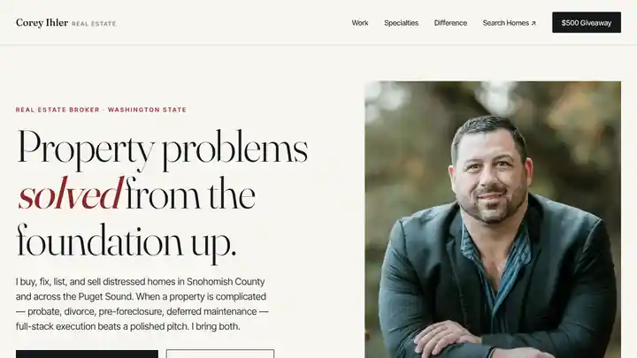

# Corey Ihler Real Estate website

Live site: **[coreyihlerrealestate.com](https://coreyihlerrealestate.com)**



Marketing and lead-capture website for Corey Ihler, real estate broker with Keller Williams North Sound, serving Snohomish County and the Puget Sound. Static HTML, CSS and vanilla JavaScript with no build step, deployed on Cloudflare Pages.

## What's on the site

- **Homepage:** services, specialties and how Corey works
- **Giveaway entry page:** a sweepstakes lead-capture form with official rules and a thank-you page
- **Compliance pages:** privacy policy and terms of use written for A2P 10DLC text-messaging registration
- **Search basics:** sitemap.xml and robots.txt
- **Cloudflare Pages config:** security and cache headers (`_headers`) and legacy-path redirects (`_redirects`)

## Consent record keeping

The entry form records a full consent record with every submission: timestamp, page URL, referrer, browser, a version ID for the exact consent text shown, every field value and the state of every checkbox. If the network is down (for example, on a tablet at an event booth), entries are saved locally and sent later.

## Structure

```
public/
├── index.html            homepage
├── monroe-giveaway.html  giveaway entry form
├── official-rules.html   sweepstakes official rules
├── thank-you.html        post-submission page
├── privacy.html          privacy policy
├── terms.html            terms of use
├── styles.css            design system
├── _headers, _redirects  Cloudflare Pages config
├── robots.txt, sitemap.xml
└── images/
```

Cloudflare Pages deploys the `public/` folder automatically on every push to `main`.

## Stack

HTML, CSS, vanilla JavaScript, Google Fonts (Fraunces and Inter Tight), Cloudflare Pages

## About

Built and maintained by [Chris Ihler](https://github.com/ChrisIhler), AI implementation and automation consultant. Available for website and automation work on [Upwork](https://www.upwork.com/freelancers/chrisihler).
